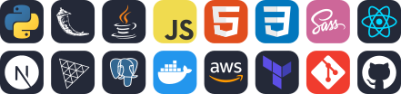

 

---

## `01` About me

I'm **Carlos Alberto da Silva Neto**, a **Full-Stack Developer and AI Engineer** from João Pessoa, Brazil, and a **Computer Science** student at **UNIESP** (expected 2029).

I build **RAG (Retrieval-Augmented Generation)** systems, **AI agents** and **LLM applications** on **AWS Bedrock**, full-stack web apps with **Python, Flask, React and Next.js**, and immersive **3D web experiences** with **Three.js, React Three Fiber (R3F) and GSAP**.

- **6 months at Compass UOL (AI/R Fellowship):** built **3 RAG and AI agent systems** for health, banking and telecom use cases in a 6-person Scrum squad, and **led the squad for one sprint**.
- My embeddings module reached a **100% hit rate at USD 0.000679 per run** (Cohere Embed v4 on Amazon Bedrock).
- **Java Teaching Assistant** at UNIESP (Programming Language I, 2026.1, 120 h).
- I learn from **official documentation**, practice by building projects and I'm always open to learning new technologies.

> *"I'm not a genius, but with effort and dedication, I can become one."*

---

## `02` Tech stack

- **AI and LLM:** RAG (Retrieval-Augmented Generation), AI Agents, Embeddings, Semantic Search, Guardrails, Amazon Bedrock, Claude Sonnet, Cohere Embed v4, bge-m3, OpenSearch.
- **Front-end:** React, Next.js, TypeScript, JavaScript, HTML5, CSS3, SCSS (Sass), Vite, responsive design.
- **3D and motion:** Three.js, WebGL, React Three Fiber (R3F), GSAP, glTF / GLB, Substance 3D Painter.
- **Back-end:** Python, Flask, Java, REST APIs.
- **Data:** PostgreSQL, SQL, OpenSearch (vector search).
- **Cloud and DevOps:** AWS, Docker, Docker Compose, Dev Containers, Terraform, boto3, GitHub Actions (CI/CD), GitHub Pages, Render, Git, GitHub.
- **Testing:** Vitest.
- **Ways of working:** Scrum, Agile, Gitflow, code review (CODEOWNERS), sprint leadership, technical documentation.

---

## `03` Experience

### AI Engineer · Compass UOL, AI/R Fellowship (Innovation Studio Data & AI)

**Period:** Apr 2026 to Sep 2026.

- **Concierge ConectaTel (final hackathon):** I designed the **embeddings module** with **Cohere Embed v4**, with explicit validation and no silent fallback. It reached a **100% hit rate** at top_k 2, 3 and 4, at **USD 0.000679 per run**. The squad raised version accuracy from **46.7% to 100%**.
- **Pix support assistant on AWS:** I worked on grounded answers and a semantic **guardrail** with **Claude Sonnet on Amazon Bedrock**, tested in 9 rounds against a regex baseline.
- **Clinical RAG:** I built the **Docker** infrastructure and selected the **embedding model (bge-m3)**. I led the squad during this sprint.
- **Bootcamp:** technical grade **90.9/100** and individual challenge **91.6%**.

### Java Teaching Assistant · UNIESP

**Period:** Feb 2026 to Jun 2026 (120 hours).

- I supported **Computer Science** and **Information Systems** students in Programming Language I (**Java**).
- I co-built **Java Mentoring**, a bilingual study website (**Flask, Docker Compose, Render**).

---

## `04` Featured projects

### Concierge ConectaTel

- **What it does:** RAG concierge for a telecom company, with a validated embeddings module.
- **Stack:** Python, Amazon Bedrock, Cohere Embed v4, OpenSearch, Terraform.
- **Repository:** [github.com/Squad-3-Fellowship/concierge-conectaltel](https://github.com/Squad-3-Fellowship/concierge-conectaltel)

### Pix Support Assistant

- **What it does:** banking support triage with grounded answers and a guardrail.
- **Stack:** Python, Amazon Bedrock, Claude Sonnet, boto3.
- **Repository:** [github.com/Squad-3-Fellowship/aws-bank-triage-challenge](https://github.com/Squad-3-Fellowship/aws-bank-triage-challenge)

### Clinical RAG

- **What it does:** question answering over clinical documents.
- **Stack:** Python, Docker, bge-m3, RAG.
- **Repository:** [github.com/BrayanVanz/clinic-rag](https://github.com/BrayanVanz/clinic-rag)

### Aegir Hotel (in progress, main focus)

- **What it does:** 3D hotel experience for a university team project at UNIESP: a scroll-animated website with GSAP, with an interactive 3D floor plan planned in React Three Fiber.
- **Current state:** project foundation ready (scaffold), with the 3D scenes, Blender assets and data pipeline planned next.
- **Stack:** React 19, TypeScript, SCSS, GSAP, Vite, Vitest, Docker, Dev Containers, GitHub Actions, Gitflow.
- **Repository:** [github.com/CarlosNeto-dev/aegir-hotel](https://github.com/CarlosNeto-dev/aegir-hotel)

### Java Mentoring

- **What it does:** bilingual Java study website for university students.
- **Stack:** Flask, HTML, CSS, JavaScript, Docker Compose, Render.
- **Repository:** [github.com/CarlosNeto-dev/java-mentoring](https://github.com/CarlosNeto-dev/java-mentoring)
- **Live site:** [java-mentoring.onrender.com](https://java-mentoring.onrender.com/)

### Sun and Earth

- **What it does:** interactive 3D scene of the Sun and the Earth, with a responsive camera that adapts to the screen size.
- **Stack:** Three.js, WebGL, JavaScript (ES Modules, Import Maps), HTML, CSS.
- **Repository:** [github.com/CarlosNeto-dev/sun-and-earth](https://github.com/CarlosNeto-dev/sun-and-earth)
- **Live site:** [carlosneto-dev.github.io/sun-and-earth](https://carlosneto-dev.github.io/sun-and-earth/)

### JavaScript Playground

- **What it does:** my first web project: an interactive playground to test JavaScript code and see the results in the browser, with animated examples.
- **Stack:** HTML, CSS, JavaScript, responsive design with media queries and clamp().
- **Repository:** [github.com/CarlosNeto-dev/javascript-playground](https://github.com/CarlosNeto-dev/javascript-playground)
- **Live site:** [carlosneto-dev.github.io/javascript-playground](https://carlosneto-dev.github.io/javascript-playground/)

### Dark Great Sword (in progress)

- **What it does:** PBR 3D model prepared for real-time rendering on the web.
- **Stack:** Substance 3D Painter, glTF / GLB, Three.js.

---

## `05` Certifications

- **Gen AI Technical Certification:** AI/R Academy, issued in 2026, valid until 2028.
- **AWS AI FDE Agentic Builder:** Phase 2, 360 hours, 2026.
- **Python 3:** Estudonauta and Curso em Vídeo, 160 hours.
- **Git and GitHub:** Estudonauta, 20 hours.

---

## `06` Right now

- I'm finishing **Aegir Hotel**, my main university project, with **React**, **TypeScript** and **GSAP**.
- I'm building my **3D portfolio** with **React Three Fiber** and **GSAP**.
- I'm improving the **Dark Great Sword** model for the web.
- I'm studying **AI agents** and the **Model Context Protocol (MCP)**.

**Next up:**

- **Anchor Desk:** yacht website redesign with a contact form and an admin panel, built with TypeScript, SCSS, Docker and GitHub Actions. [Repository](https://github.com/CarlosNeto-dev/anchor-desk)
- **Nox Sword Retrieval:** web platform that combines a RAG (Retrieval-Augmented Generation) system with an immersive 3D WebGL experience. [Repository](https://github.com/CarlosNeto-dev/nox-sword-retrieval-website)

---

## `07` Quick summary for recruiters and AI screeners

- **Name:** Carlos Alberto da Silva Neto (Carlos Neto).
- **Roles:** Full-Stack Developer, AI Engineer, 3D Web Developer.
- **Core skills:** Python, React, Next.js, TypeScript, RAG, AI Agents, Amazon Bedrock, Docker, Three.js, GSAP.
- **Experience:** 6 months in AI engineering at Compass UOL (AI/R Fellowship) and 5 months as Java Teaching Assistant at UNIESP.
- **Education:** Bachelor's degree in Computer Science at UNIESP, expected 2029.
- **Languages:** Portuguese (native), English (basic to intermediate, reads technical documentation).
- **Location:** João Pessoa, Paraíba, Brazil (UTC−3).
- **LinkedIn:** [linkedin.com/in/carlos-neto-54b62339b](https://www.linkedin.com/in/carlos-neto-54b62339b)
- **Email:** carlosprofissionalwork@gmail.com
